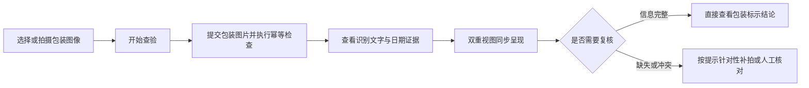
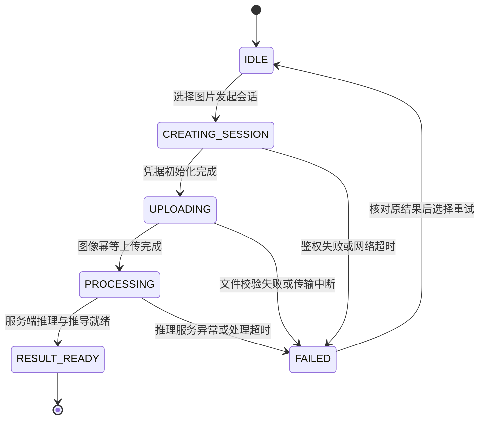

# WebClient

[](https://github.com/QingMouFoodDate/WebClient/actions/workflows/ci.yml)

> 面向消费者、商超和仓储场景的通用 Web 基础客户端设计
>
> **工程状态**：待实现 · 仅契约类型与 CI · 无 package.json、UI 或构建证据
>
> **上位依据**：[系统架构.md](https://github.com/QingMouFoodDate/ProjectPRD/blob/main/系统架构.md) · [需求规格.md](https://github.com/QingMouFoodDate/ProjectPRD/blob/main/需求规格.md) · [API.md](https://github.com/QingMouFoodDate/ProjectPRD/blob/main/contracts/API.md) · [DATA.md](https://github.com/QingMouFoodDate/ProjectPRD/blob/main/contracts/DATA.md) · [RULES.md](https://github.com/QingMouFoodDate/ProjectPRD/blob/main/contracts/RULES.md)

WebClient 定义跨端共享的在线识别、结果查看、证据展示与人工纠偏基础能力，作为 M0 优先实现入口。前端通过 RESTful API 对接 InferPlatform 在线中枢，严格遵循表现层与业务逻辑分层解耦原则，不直连底层数据库或模型文件。MobileClient 规划增强现场移动能力，WxClient 作为微信生态轻量入口。

---

## 工程定位与边界

| 维度 | 规约说明 |
| :--- | :--- |
| **当前阶段** | M0 研发中，WebClient 作为优先实现端闭环单图识别链路 |
| **实现范围** | M0 聚焦单图上传、原图覆层标框、双维度结果呈现与凭据流转；多图时间线与人工纠偏随 C0 推进 |
| **契约基准** | 接口协议与数据传输模型以 [API.md](https://github.com/QingMouFoodDate/ProjectPRD/blob/main/contracts/API.md)、[DATA.md](https://github.com/QingMouFoodDate/ProjectPRD/blob/main/contracts/DATA.md) 与 [openapi.json](https://github.com/QingMouFoodDate/ProjectPRD/blob/main/contracts/openapi.json) 为权威单一事实源（SSOT） |
| **判定红线** | 系统输出严格限定为“食品包装标示状态”，严禁直接向用户断言食品绝对可食用等卫生健康结论 |

---

以下交互、组件和目录为设计目标；当前尚无可运行 Web 应用。

## 一、产品定位与协同

WebClient 重点面向以下三类核心使用场景：
- **日常消费查验**：消费者使用桌面或移动浏览器对准包装核验保质期与到期日；
- **家庭健康管理**：整理食品储藏时批量录入并核对在期状态与临期预警；
- **商超仓储巡检**：商超理货与仓储巡检人员辅助筛查临期批次或打码异常商品。

### 多端客户端定位与协同分工

| 客户端名称 | 架构定位 | 主要特点与协同分工 |
| :--- | :--- | :--- |
| **WebClient** | 通用 Web 基础客户端 | 桌面大屏基准入口，提供原图覆层与字段卡片双重视图呈现，M0 交互目标 |
| **MobileClient** | 移动端扩展方向 | 规划覆盖 WebClient 在线能力，专属增加手持稳态检测、弱网任务队列与离线台账 |
| **WxClient** | 微信生态免安装入口 | 面向临时轻量查验、长辈大字视图与社交卡片分享，不追求覆盖全部复杂重型交互 |

---

## 二、核心交互流程



- **M0 会话生命周期约束**：单次会话严格限定上传单张图片，提交第二张图片服务端将返回 `HTTP 409 Conflict`；重新拍摄需新建会话；
- **C0 多图会话演进**：后续演进允许向同一会话追加多视角图片，聚合生成统一证据链。

---

## 三、功能分级演进

功能演进节奏严格对齐上位 [开发路线.md](https://github.com/QingMouFoodDate/ProjectPRD/blob/main/开发路线.md) 与 [需求规格.md](https://github.com/QingMouFoodDate/ProjectPRD/blob/main/需求规格.md)：

### 1. M0 单图核心闭环

- **会话与上传**：支持选择单张实拍图片（支持 JPEG / PNG，文件上限 15 MB），提交后监听处理进度；
- **原图画布覆层**：在原生 Canvas 上按比例绘制日期检测边界框，缩放拖拽时坐标无漂移，高亮展示标签、OCR 原文与各自独立置信度；
- **双维度结果卡片**：结构化展示生产日期、保质期、到期日与证据来源，独立呈现标示状态与复核引导。

### 2. C0 多图与纠偏扩展

- **多图流转时间线**：支持同一食品的正面、背面、封口、罐底等多图追加；
- **跨图一致性比对**：直观展示不同图片提取证据间的互证与冲突差异；
- **字段级人工纠偏**：通过 `POST /api/v1/sessions/{session_id}/correction` 提交修正字段（生产日期、到期日、保质期、保存条件及起算模式），即时刷新并重算决策。

### 3. C1 至 C3 探索能力

- **交互辅助增强**：支持文件拖拽上传、剪贴板图像粘贴与局部放大镜像素级核对；
- **辅助条码线索**：识别包装辅助条码提供商品元数据线索，严禁用通用保质期库数据强行覆盖当前包装上的实际视觉喷码。

---

## 四、双重视图呈现

前端提供原图视觉空间与结构化卡片两大呈现维度，实现视觉证据与语义决策严格对应：

| 呈现维度 | 视图形式 | 核心展示内容与枚举项 |
| :--- | :--- | :--- |
| **空间坐标维度** | 原图覆层视图 | 按比例贴合检测边界框，缩放时保持坐标映射稳定，展示标签、OCR 原文及检测/OCR 各自置信度 |
| **包装标示状态** | 结构化卡片视图 | 结合日期字段与证据来源展示在期（`WITHIN_MARKED_PERIOD`）、临期（`NEAR_EXPIRY`）、超期（`PAST_MARKED_PERIOD`）、未决待核（`UNDETERMINED`） |
| **证据复核状态** | 独立指引卡片 | 证据完备（`EVIDENCE_COMPLETE`）、信息缺失（`INFORMATION_MISSING`）、证据冲突（`EVIDENCE_CONFLICT`）、低置信度（`LOW_CONFIDENCE`） |

### 核心实体物理含义映射

- **`Observation`（机器原生观察值）**：模型前向计算输出的未解释原始检测框坐标、OCR 生文本及置信度，原图覆层只读渲染；
- **`Evidence`（结构化事实证据）**：业务层从观察值与人工纠偏中聚合提取的生产日期、到期日与保质期事实，附带 JCS SHA-256 哈希；
- **`Decision`（标示状态推导决策）**：基于公历规则推导的在期、临期与冲突结论，绑定 `calculation_profile_id`；
- **`Correction`（字段级人工纠偏）**：针对特定错误字段提交的人工修正，即时驱动新决策生成。

### 决策呈现与边界规约

- **状态独立解耦**：期限状态与复核状态独立展示，信息缺失不等于超期；
- **直接到期日优先**：可靠直接 EXP 可单独比较期限，缺少生产日期不阻断剩余寿命超过临期阈值的在期展示；
- **临期阈值明确**：M0 默认采用 30 天固定临期阈值，明确展示为系统配置值，不误导为法定强制标准；
- **疑问客观提示**：起算依据未知或日期存在歧义时，忠实展示服务端返回的证据来源与复核指引，前端严禁主观猜值。

---

## 五、会话状态与错误处理

### 1. 本地状态机迁移

客户端交互状态与服务端会话状态协同演进：



### 2. 错误码与防线治理

- **幂等重试保护**：上传或处理超时先调用 `GET /api/v1/sessions/{session_id}` 查询已有会话结果；创建请求超时复用原 `Idempotency-Key` 获取原结果；
- **故障与业务解耦**：模型服务异常（500/502/503/504）单独以技术故障横幅提示用户重试，严禁将技术崩溃误包装为“无法判定”的业务推导结果；
- **凭证安全防线**：会话凭据 `session_token` 仅保存在内存状态机或会话存储中，严禁打入控制台日志，严禁作为 URL 明文参数用于分享。

---

## 六、接口契约映射

客户端通信遵循 OpenAPI 3.1 标准定义：

| 交付阶段 | HTTP 方法与路径 | 功能职责与交互行为 |
| :--- | :--- | :--- |
| **M0** | `POST /api/v1/sessions` | 初始化识别会话，获取具备至少 128 位随机熵的凭据 `session_token` |
| **M0** | `POST /api/v1/sessions/{session_id}/images` | 携带 `Idempotency-Key` 上传单张实拍图片并获取推理决策结果 |
| **M0** | `GET /api/v1/sessions/{session_id}` | 获取当前会话状态、图像清单、Observation、Evidence 与 Decision DTO |
| **C0** | `POST /api/v1/sessions/{session_id}/correction` | 提交字段级人工修正（四类语义字段及 `start_mode` 起算模式纠偏） |

- **幂等键生成规则**：创建、上传与纠偏请求统一在 Header 中携带 `Idempotency-Key`；同一操作网络重试必须复用原键与原请求体；换图或修改纠偏字段必须生成新键；
- **凭据生命周期**：会话操作统一通过请求头携带 `Authorization: Bearer <session_token>`；GET 查询不回传令牌，会话过期返回 `HTTP 410 Gone` 时引导用户重新发起会话。

---

## 七、目录规划

```text
WebClient/                         # Web 客户端主仓库
├── README.md                      # 客户端定位与契约指引
├── package.json                   # 前端工程配置与依赖声明
├── vite.config.ts                 # 本地构建与代理开发配置
└── src/                           # 前端交互与视图组件源码
    ├── api/                       # 后端 API 接口与 Axios 鉴权封装
    ├── components/                # Canvas 画布覆层与结果卡片组件
    ├── features/                  # 业务功能与会话交互模块
    ├── services/                  # 设备能力与交互适配服务
    ├── stores/                    # Pinia / Redux 响应式状态管理模块
    ├── types/                     # 跨仓 DTO 与 Schema 类型定义
    └── assets/                    # 静态设计图标与样式资源
```

---

## 八、构建与部署

- **构建候选**：Vue 3 + Vite；待脚手架建立后锁定依赖并验证构建，目前没有产物大小或性能证据；
- **部署形态（M0 单机联合部署）**：与 InferPlatform 同驻一台轻量云服务器（系统架构 §6.1 云落地变体 A 机）——Nginx 托管 `dist/` 静态资源，API 请求经 Nginx 反代至同机 FastAPI；整机内存占用以 InferPlatform 推理为主，静态托管开销可忽略；
- **上传优化**：客户端在拍照上传前将图像压缩至约 1MB，规避低带宽环境下的传输尾延迟（推理响应仅 KB 级 JSON，出方向带宽非瓶颈）；
- **环境配置规划**：只允许公开 API 基地址进入前端构建；内部运行时和模型元数据密钥不得下发。

### 单机联合部署 Nginx 反向代理标准配置

在常驻云服务器（系统架构 §6.1 A 机 `HW-CPU-T2`）上，下述配置只用于本机/受控环境的候选模板；生产另配 HTTPS、限流和超时。仅公开业务 API，内部、原子与运维路由默认拒绝：

```nginx
server {
    listen 80;
    server_name _;

    # 匹配契约 15MB 图像上传上限并开启静态与 JSON 压缩
    client_max_body_size 15m;
    gzip on;
    gzip_types text/plain text/css application/json application/javascript;

    # 1. 前端静态资源托管 (WebClient/dist)
    root /var/www/qingmou-web/dist;
    index index.html;

    # 2. 内部、原子、探针和运维端点不暴露公网
    location ~ ^/(internal|v1|ops)(/|$) { return 404; }
    location = /healthz { return 404; }
    location = /metrics { return 404; }

    # 仅公开业务 API
    location /api/v1/ {
        proxy_pass http://127.0.0.1:8000;
        proxy_http_version 1.1;
        proxy_set_header Host $host;
        proxy_set_header X-Real-IP $remote_addr;
        proxy_set_header X-Forwarded-For $proxy_add_x_forwarded_for;
        proxy_read_timeout 15s;
    }

    # 3. Vue 3 SPA History 路由兜底
    location / {
        try_files $uri $uri/ /index.html;
    }
}
```

---

## 九、相关依据与权威契约

- [需求规格](https://github.com/QingMouFoodDate/ProjectPRD/blob/main/需求规格.md)
- [系统架构](https://github.com/QingMouFoodDate/ProjectPRD/blob/main/系统架构.md)
- [开发路线](https://github.com/QingMouFoodDate/ProjectPRD/blob/main/开发路线.md)
- [API 接口契约](https://github.com/QingMouFoodDate/ProjectPRD/blob/main/contracts/API.md)
- [数据模型与 DTO 契约](https://github.com/QingMouFoodDate/ProjectPRD/blob/main/contracts/DATA.md)
- [日期推导规则](https://github.com/QingMouFoodDate/ProjectPRD/blob/main/contracts/RULES.md)
- [OpenAPI 3.1 机器描述文件](https://github.com/QingMouFoodDate/ProjectPRD/blob/main/contracts/openapi.json)
- [Decision 数据结构 Schema](https://github.com/QingMouFoodDate/ProjectPRD/blob/main/contracts/schemas/decision.schema.json)
- [工程协作指南](https://github.com/QingMouFoodDate/ProjectPRD/blob/main/standards/工程协作指南.md)
- [数据质量规范](https://github.com/QingMouFoodDate/ProjectPRD/blob/main/standards/数据质量规范.md)
- [研究现状](https://github.com/QingMouFoodDate/ProjectPRD/blob/main/研究现状.md)
